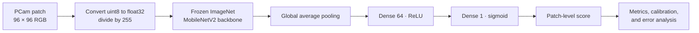
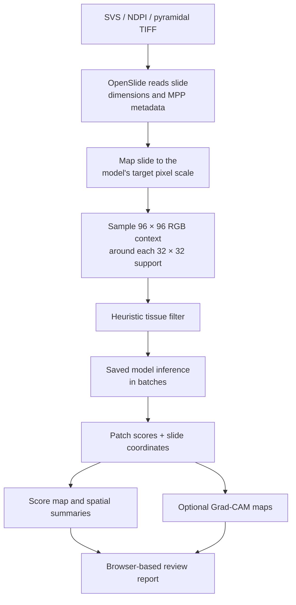

# How the code fits together

Project Patho has two related workflows. One evaluates patch-level classifiers. The other applies a saved classifier to a whole-slide image and displays its patch scores. They should not be treated as the same experiment.

## 1. Patch-classification and evaluation

The older checkpoint, `whole-slide-processing-model-testing/models/my_cancer_model.h5`, is described in the recovered source audit as a MobileNetV2-based patch classifier. The diagram shows the architecture recorded there; it is not a claim that every checkpoint in the repository has the same architecture.

The architecture above is reconstructed from `source_audit.json`. That audit also says the retained notebook contains a commented training call and that the historical training sequence could not be recovered completely. See [Data and model record](DATA_AND_MODEL.md).

A separate November 11, 2026 training record is associated with `model-generalization-testing/runs/2026-11-11/model.keras` and a different manifest. Its manifest and `run.json` disagree about input scaling. Do not assume that this checkpoint is identical to the older H5 model or that its evaluation is fully reproducible until that disagreement is resolved.

## 2. Whole-slide review

The Colab notebooks load an existing H5 checkpoint. They do not train a model. The current whole-slide path is:

The 96 × 96 context is centered on a 32 × 32 support. The support is the region to which the score is assigned. The filter uses brightness and color variation; it is not a trained tissue-segmentation model, and it can exclude real tissue. Skipped supports remain unscored.

The report displays an overview and score maps. It does not embed the original slide at diagnostic resolution. Grad-CAM is an attribution map, not a tumor boundary or proof of what the model learned.

## What the diagram does not imply

- A patch score is not a patient diagnosis.
- A group of adjacent high-scoring patches is not a confirmed lesion.
- A full grid scan is not clinical validation.
- A visually convincing heatmap does not establish that the model generalizes to another hospital or scanner.
